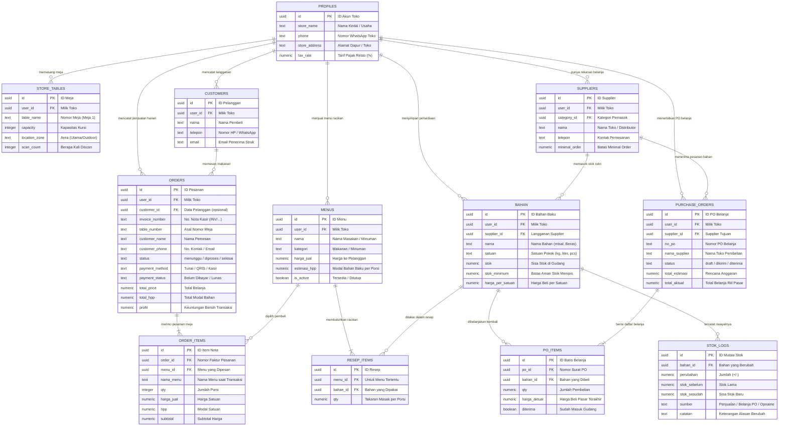

# DapurTwin 🍳🦊

> **Sistem Operasional Dapur, Manajemen Inventori Bahan Baku, dan Kalkulasi HPP (*Harga Pokok Penjualan*) Otomatis untuk Bisnis F&B dan UMKM Kuliner.**

DapurTwin adalah platform operasional dapur dan kasir POS modern yang dirancang untuk mengatasi persoalan mendasar bisnis kuliner: ketidakpastian stok bahan baku, resep yang belum terstandarisasi, kebocoran bahan, kesulitan menghitung margin dan HPP per porsi, serta antrean pesanan yang terfragmentasi antara kasir dan meja makan.

Dilengkapi dengan maskot interaktif **Dapi** yang responsif terhadap data operasional dapur secara *real-time*, DapurTwin menjamin pencatatan transaksi, pemotongan stok otomatis, hingga pengiriman struk digital berjalan tanpa hambatan.

---

## 📌 Fitur Unggulan

### 1. Self-Order Meja Pelanggan via QR Code (`/order/[storeId]`)
- **Pemesanan Mandiri Tanpa Antre**: Pelanggan memindai QR code di meja untuk membuka katalog menu interaktif langsung dari peramban ponsel pintar tanpa perlu memasang aplikasi.
- **Katalog Menu Dinamis**: Menampilkan foto, nama menu, harga, badge kategori, dan status ketersediaan porsi secara *live*.
- **Pilihan Pembayaran Fleksibel**:
  - **QRIS Dinamis**: Pembayaran langsung di meja menggunakan e-Wallet / m-Banking dengan konfirmasi dan struk digital instan.
  - **Bayar di Kasir**: Pesanan langsung diteruskan ke antrean dapur; struk digital otomatis dikirimkan ke email pelanggan segera setelah kasir mengonfirmasi penerimaan pembayaran lunas.
- **Validasi Kuantitas & Batas Stok**: Mencegah pelanggan memesan menu melebihi sisa porsi bahan yang tersedia di dapur.

### 2. Generator & Manajemen QR Meja (`/dashboard/qr-meja`)
- **Kelola Meja Dinamis**: Tambah, ubah nomor meja, atur kapasitas kursi, dan tentukan lokasi meja (Area Utama, Indoor, Outdoor, Lantai 2).
- **Desain Kartu Meja Siap Cetak**: Pratinjau kartu akrilik meja elegan dengan nomor meja tegas, kode QR resolusi tinggi, instruksi ringkas 3 langkah scan, dan maskot Dapi.
- **Ekspor Dokumen**: Unduh kartu meja dalam format gambar PNG siap pajang dan cetak langsung ke kertas/printer kasir.

### 3. Kitchen Display System & Proses Pesanan (`/dashboard/proses-pesanan`)
- **Papan Kendali Antrean Dapur Terpadu**: Mengintegrasikan seluruh pesanan masuk dari meja mandiri (Self-Order), kasir toko langsung, pesanan WhatsApp, hingga layanan pesan antar (GoFood, GrabFood, ShopeeFood).
- **Indikator Kesiapan Bahan Resep Real-Time**: Sistem otomatis memeriksa ketersediaan stok bahan di gudang terhadap kebutuhan resep pesanan:
  - Label hijau: *Bahan Tersedia* (siap diproses).
  - Label merah: *Bahan Kurang* (disertai rincian kekurangan bahan spesifik).
- **Siklus Status Pesanan**: Alur pemrosesan jelas: *Menunggu Konfirmasi* $\rightarrow$ *Sedang Dimasak / Diproses* $\rightarrow$ *Pesanan Selesai Siap Saji*.
- **Konfirmasi Pelunasan & Kirim Struk Kasir**: Tombol *"Terima Kasir (Lunas)"* untuk pesanan meja dengan pengiriman otomatis struk resmi ke email pelanggan via Resend API.

### 4. Kasir POS & Pemotongan Stok Otomatis Berbasis Resep (`/dashboard/penjualan`)
- **Multi-Channel Sales**: Mendukung penjualan *Toko Langsung / Dine-in*, *Pesanan WhatsApp*, *GoFood*, *GrabFood*, dan *ShopeeFood*.
- **Live Stock Deduction**: Saat pesanan diselesaikan, stok seluruh bahan baku yang tertera pada resep (*Bill of Materials*) otomatis terpotong dari gudang dan tercatat di riwayat mutasi stok.
- **Kalkulator Pembayaran & Kembalian**: Penghitungan uang tunai, diskon, opsi pajak (inklusif/eksklusif), dan integrasi pembayaran QRIS Dinamis.
- **Cetak Struk Kasir & WhatsApp**: Nota kasir termal siap cetak atau dibagikan ke nomor kontak pelanggan.

### 5. Katalog Menu & Kalkulator HPP (*Bill of Materials*) (`/dashboard/menu`)
- **Penyusunan Resep Presisi**: Tautkan berbagai bahan baku ke dalam satu menu porsi saji.
- **Engine Konversi Satuan Cerdas (`lib/satuan.ts`)**: Otomatis mengonversi satuan takaran resep (`gram`, `sdm`, `sdt`, `ml`) ke satuan master bahan baku di gudang (`kg`, `liter`, `pcs`).
- **Live HPP & Margin Profit**: Kalkulasi otomatis modal bahan baku dan persentase laba kotor saat menentukan harga jual.
- **Pencarian Resep AI (`/api/ai-resep`)**: Fitur cerdas yang mengusulkan takaran bahan dan perkiraan komposisi resep masakan secara otomatis.

### 6. Pengadaan Bahan Baku (Purchase Order) & OCR Nota (`/dashboard/purchase-order`)
- **Siklus PO Terintegrasi**: Alur pembuatan PO ke supplier terdaftar maupun pembelian pasar langsung (*Tanpa Supplier*), dengan status: *Draf* $\rightarrow$ *Kirim ke Supplier* $\rightarrow$ *Diterima*.
- **Verifikasi Penerimaan Barang**: Rekonsiliasi jumlah barang yang dipesan vs aktual yang diterima, input selisih harga pasar, serta opsi update otomatis harga master bahan di gudang.
- **Otomatisasi Stok & Tagihan**: Saat PO berstatus diterima, stok gudang otomatis bertambah dan faktur tagihan tempo otomatis tercatat di modul Keuangan.
- **AI OCR Scan Nota Fisik (`/dashboard/ocr-nota`)**: Pindai foto struk belanja pasar/supermarket menggunakan AI Vision untuk mengekstrak nama barang, kuantitas, dan harga secara instan menjadi data digital.

### 7. Manajemen Inventori, Kartu Stok & Kesegaran Bahan (`/dashboard/bahan`)
- **Master Bahan Baku**: Pengaturan stok minimum (*safety stock*), peringatan dini bahan habis (*Habis*, *Rendah*, *Aman*), dan harga pokok.
- **Audit Log Mutasi & Stock Opname (`/dashboard/stok-log`)**: Riwayat jejak audit keluar-masuk barang (dari PO, Penjualan POS, atau penyesuaian manual/waste) serta fitur rekonsiliasi stok fisik gudang.
- **Monitoring Kedaluwarsa & Shelf-Life (`/dashboard/kondisi-bahan`)**: Estimasi masa simpan bahan segar sejak tanggal penerimaan dengan rekomendasi penyimpanan agar meminimalisir *food waste*.

### 8. Tagihan Supplier & Keuangan Operasional (`/dashboard/tagihan`)
- **Manajemen Hutang Tempo**: Pelacakan tanggal jatuh tempo faktur supplier, status *Belum Lunas*, *Lunas*, atau *Jatuh Tempo (Overdue)*.
- **Pencatatan Pembayaran**: Rekam metode pembayaran dan nomor referensi bukti pelunasan faktur.

### 9. Analitik, Laporan & Simulasi Bisnis (`/dashboard/laporan`)
- **Laporan Penjualan & Profit**: Visualisasi omzet, total HPP terpakai, laba kotor (*Gross Profit*), dan rata-rata nilai transaksi (*AOV*) dengan filter periode fleksibel (7 hari, 30 hari, bulan ini, dsb).
- **Rekomendasi Cerdas (`/dashboard/rekomendasi`)**: Saran proaktif pengadaan stok sebelum jam sibuk dan deteksi menu yang kurang laku (*deadstock*).
- **Simulasi Proyeksi Bisnis (`/dashboard/simulasi`)**: Uji coba skenario target kenaikan porsi penjualan, perhitungan kebutuhan pasokan bahan batch katering, dan simulasi dampak kenaikan harga bahan distributor terhadap margin keuntungan.

### 10. Asisten Maskot Dapi & Proteksi Antarmuka
- **Living Mascot Dapi**: Maskot interaktif berbasis SVG murni yang responsif terhadap data riil dapur (senang saat ada omzet, cemas saat stok kritis menipis).
- **Global Action Blocker (`BusyContext`)**: Mengunci tombol dan aksi antarmuka saat sistem sedang memproses transaksi atau mutasi data untuk mencegah *double submit* atau tabrakan data jaringan.
- **Konfirmasi Aksi Aman (`ConfirmModal`)**: Seluruh aksi penghapusan dan pengubahan status divalidasi melalui modal konfirmasi kustom ramah pengguna tanpa dialog bawaan browser yang mengganggu.
- **Email Transaksional Otomatis**: Integrasi API Resend untuk pengiriman struk digital pelanggan dan alert operasional ke email pemilik usaha.

---

## 🛠️ Stack Teknologi

| Komponen | Teknologi | Keterangan |
| :--- | :--- | :--- |
| **Framework** | [Next.js 16 (App Router)](https://nextjs.org/) | React Server Components & Serverless API Routes |
| **Library UI** | [React 19](https://react.dev/) | Arsitektur UI berbasis komponen modular reaktif |
| **Styling** | [Tailwind CSS v4](https://tailwindcss.com/) | Desain *warm claymorphism* khas DapurTwin |
| **Bahasa** | [TypeScript v5](https://www.typescriptlang.org/) | Menjamin keamanan tipe (*type safety*) di seluruh alur |
| **Database & Auth** | [Supabase](https://supabase.com/) | PostgreSQL 15+, Supabase Auth, Row Level Security (RLS) |
| **Visualisasi Data**| [Recharts](https://recharts.org/) | Diagram grafik tren omzet, arus kas, dan breakdown penjualan |
| **Ikonografi** | [Lucide React](https://lucide.dev/) | Paket ikon modern, bersih, dan konsisten |
| **Payment Gateway** | [Midtrans Core API](https://midtrans.com/) | Pembayaran QRIS Dinamis otomatis |
| **Email Service** | [Resend](https://resend.com/) | Pengiriman email transaksi dan struk digital resmi |
| **AI & OCR** | 9Router (Gemini Vision) & Tesseract.js | Pemindaian nota fisik & rekomendasi racikan resep AI |

---

## 📂 Struktur Direktori

DapurTwin menerapkan arsitektur **Feature-First Colocated**, di mana setiap domain fitur mengelompokkan komponen, hooks, services, dan types miliknya sendiri:

```text
src/
├── app/
│   ├── (public)/
│   │   ├── page.tsx                           # Landing page & onboarding interaktif Dapi
│   │   └── login/                             # Halaman autentikasi masuk & daftar akun
│   ├── order/
│   │   └── [storeId]/                         # Portal pemesanan mandiri meja pelanggan (QR Order)
│   ├── dashboard/
│   │   ├── page.tsx                           # Overview / Pusat kendali utama dapur
│   │   ├── (pos)/
│   │   │   ├── penjualan/                     # Kasir POS & pemotongan stok otomatis
│   │   │   ├── proses-pesanan/                # KDS / Antrean dapur & verifikasi bahan resep
│   │   │   ├── qr-meja/                       # Manajemen & pencetakan kartu QR meja
│   │   │   └── menu/                          # Manajemen menu, resep (BOM), & HPP
│   │   ├── (purchasing)/
│   │   │   ├── purchase-order/                # Pembelian stok bahan & verifikasi masuk
│   │   │   ├── suppliers/                     # Direktori kontak distributor / supplier
│   │   │   └── ocr-nota/                      # AI scan struk belanja pasar fisik
│   │   ├── (inventory)/
│   │   │   ├── bahan/                         # Master bahan baku & safety stock
│   │   │   ├── stok-log/                      # Audit mutasi stok & stock opname fisik
│   │   │   └── kondisi-bahan/                 # Estimasi kesegaran & masa kedaluwarsa
│   │   ├── (finance)/
│   │   │   └── tagihan/                       # Faktur hutang dagang supplier
│   │   ├── (analytics)/
│   │   │   ├── laporan/                       # Laporan penjualan, omzet, & laba kotor
│   │   │   ├── riwayat/                       # Arsip transaksi kasir & pesanan PO
│   │   │   ├── rekomendasi/                   # Saran analitik cerdas operasional
│   │   │   └── simulasi/                      # Simulasi margin, supply batch, & harga
│   │   └── pengaturan/                        # Profil toko & preferensi notifikasi
│   └── api/                                   # API route & webhook pembayaran/email
├── components/                                # Komponen global (Topbar, Sidebar, Modal, Logo)
│   └── ui/                                    # Komponen DapiMascot, ConfirmModal, Pagination, StatCard
├── context/                                   # ToastContext & BusyContext (global action hold)
├── hooks/                                     # Custom hooks global
├── lib/
│   ├── satuan.ts                              # Engine konversi unit takaran resep ke master
│   ├── supabase/                              # Klien Supabase (client, server, middleware)
│   └── resend.ts                              # Konfigurasi pengiriman email struk transaksi
└── services/                                  # Layanan integrasi data & API
```

---

## 🗄️ Struktur Database & Alur Data Dapur (Supabase)

Agar operasional dapur berjalan lancar, DapurTwin mengelompokkan data ke dalam 4 pos utama: **Toko & Supplier**, **Gudang Bahan & Resep Menu**, **Meja & Kasir Penjualan**, serta **Belanja Bahan (PO) & Sistem**. 

Setiap data toko terlindungi secara aman (*multi-tenant*) menggunakan `user_id`, sehingga data tiap pemilik usaha tidak akan pernah tertukar.

### Diagram Relasi Tabel (ERD DapurTwin)

Berikut gambaran bagaimana menu, stok bahan di gudang, meja makan, dan transaksi penjualan saling terhubung secara otomatis:



---

### Panduan Tabel untuk Pengelola Dapur & Kasir

Biar gampang dipahami, berikut fungsi tiap tabel dalam operasional harian kedai atau resto Anda:

#### 1. Toko, Pelanggan, & Rekanan Belanja
* **`profiles` (Profil Kedai/Dapur)**: Menyimpan nama usaha Anda, alamat kedai, WhatsApp, dan aturan pajak resto (misal: PB1 10%).
* **`store_tables` (Meja Makan QR)**: Mengatur nomor meja, kapasitas kursi, dan area makan (misal: *Lantai 1*, *Outdoor*). Setiap meja punya kode QR unik yang discan pelanggan.
* **`customers` (Buku Tamu Pelanggan)**: Menyimpan nama dan email pelanggan agar struk digital bisa langsung terkirim otomatis saat bayar.
* **`suppliers` & `supplier_categories` (Kontak Supplier)**: Buku kontak langganan tempat Anda belanja (toko daging, pasar sayur, distributor packaging) beserta info minimal order.
* **`supplier_riwayat` (Catatan Bayar Supplier)**: Rekam jejak bukti transfer atau pembayaran nota ke pihak supplier.

#### 2. Dapur: Bahan Baku, Resep Menu, & Stok Otomatis
* **`bahan` (Gudang Bahan Baku)**: Mencatat stok fisik bumbu, sayur, daging, atau cup minuman di gudang lengkap dengan batas peringatan bahan mau habis (*safety stock*).
* **`menus` (Daftar Menu & Harga)**: Daftar makanan dan minuman yang Anda jual beserta harga ke pembeli dan modal per porsinya.
* **`resep_items` (Buku Resep / Takaran Masak)**: Menghubungkan menu dengan bahan bakunya. Misal 1 porsi *Ayam Geprek Sambal Bawang* butuh 1 potong ayam, 50 gram tepung, dan 5 butir cabai. Saat ada pesanan, stok bahan ini yang otomatis dipotong sistem.
* **`stok_logs` (Buku Catatan Keluar-Masuk Stok)**: Catatan riwayat mutasi barang: kapan bahan berkurang karena dimasak, kapan bertambah karena baru belanja dari pasar, atau jika ada bahan yang terbuang (*waste*).

#### 3. Kasir: Transaksi Penjualan & Antrean Dapur
* **`orders` (Nota Penjualan Kasir & Meja)**: Induk setiap transaksi. Mencatat nomor nota (`INV/...`), asal meja, total bayar, metode bayar (Tunai atau QRIS), dan status pembayaran (*Belum Dibayar* atau *Lunas*).
* **`order_items` (Rincian Menu yang Dipesan)**: Merinci menu apa saja yang dibeli di tiap nota pesanan beserta jumlah porsi dan harga saat transaksi berlangsung.

#### 4. Pengadaan Bahan (PO), Bantuan AI, & Notifikasi
* **`purchase_orders` & `po_items` (Surat Belanja Bahan)**: Daftar belanja bahan saat stok menipis. Mencatat perkiraan biaya vs harga pasar aktual saat belanjaan tiba di dapur. Saat status diubah jadi *"Diterima"*, stok di gudang langsung bertambah otomatis.
* **`ocr_receipts` (Pindai Struk Pasar)**: Tempat arsip hasil foto struk belanja pasar fisik yang dibaca otomatis oleh AI agar Anda tidak perlu mengetik satu per satu.
* **`rekomendasi` (Saran Pintar Dapur)**: Analisis pintar yang memberi tahu Anda menu mana yang paling laris dan bahan apa yang wajib segera dibelanjakan sebelum jam buka kedai.
* **`notifications` (Pemberitahuan Cepat)**: Pesan pengingat yang langsung muncul saat ada bahan yang hampir habis atau tagihan tempo supplier yang mendekati jatuh tempo.

---

## 🚀 Panduan Instalasi Lokal

### 1. Prasyarat
- **Node.js**: Versi 20.x atau lebih baru.
- **npm**, **pnpm**, atau **yarn**.
- Proyek aktif di **[Supabase](https://supabase.com/)**.

### 2. Kloning Repositori & Pasang Dependensi
```bash
git clone https://github.com/username/dapurtwin.git
cd dapurtwin
npm install
```

### 3. Konfigurasi Environment Variables
Salin file `.env.example` menjadi `.env.local`:
```bash
cp .env.example .env.local
```

Lengkapi variabel konfigurasi di dalam file `.env.local`:
```env
# Supabase Configuration
NEXT_PUBLIC_SUPABASE_URL=https://your-project.supabase.co
NEXT_PUBLIC_SUPABASE_ANON_KEY=your-supabase-anon-key

# Resend Email Transactional Service
RESEND_API_KEY=re_your_resend_api_key
RESEND_FROM_EMAIL=DapurTwin <dapurtwin@your-verified-domain.com>

# Midtrans QRIS Payment Gateway (Opsional)
MIDTRANS_SERVER_KEY=your-midtrans-server-key
MIDTRANS_IS_PRODUCTION=false

# AI Vision / OCR Nota & Resep (Opsional)
NEXT_9ROUTER_URL=https://router.hitungmin.my.id/v1
NEXT_9ROUTER_KEY=your-api-key
NEXT_9ROUTER_MODEL=gemini/gemini-3.1-flash-lite
```

### 4. Setup Database Supabase
Jalankan berkas migrasi SQL yang berada di dalam folder `supabase/` pada **SQL Editor** dashboard Supabase Anda secara berurutan untuk menyiapkan tabel, indeks relasi, trigger pemotongan stok atomik, dan fungsi Row Level Security (RLS).

### 5. Jalankan Pengujian Otomatis
```bash
npm test
```

### 6. Jalankan Server Development
```bash
npm run dev
```
Buka browser di alamat [http://localhost:3000](http://localhost:3000).

---

## 📜 Lisensi & Atribusi

Proyek ini dilisensikan di bawah **MIT License**. Seluruh pustaka pihak ketiga (`Next.js`, `React`, `Tailwind CSS`, `Supabase`, `Recharts`, `Lucide React`) menggunakan lisensi open-source standar industri (**MIT**, **ISC**, dan **Apache-2.0**).
